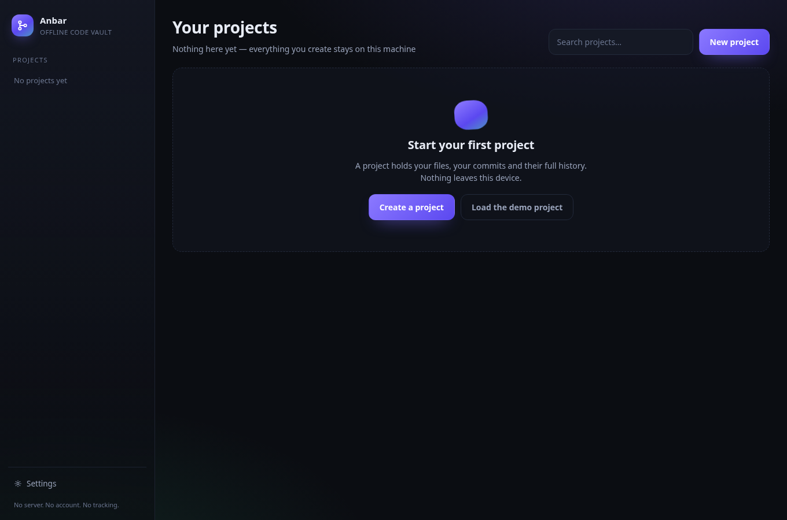
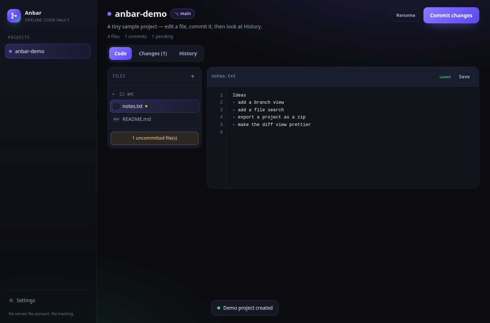
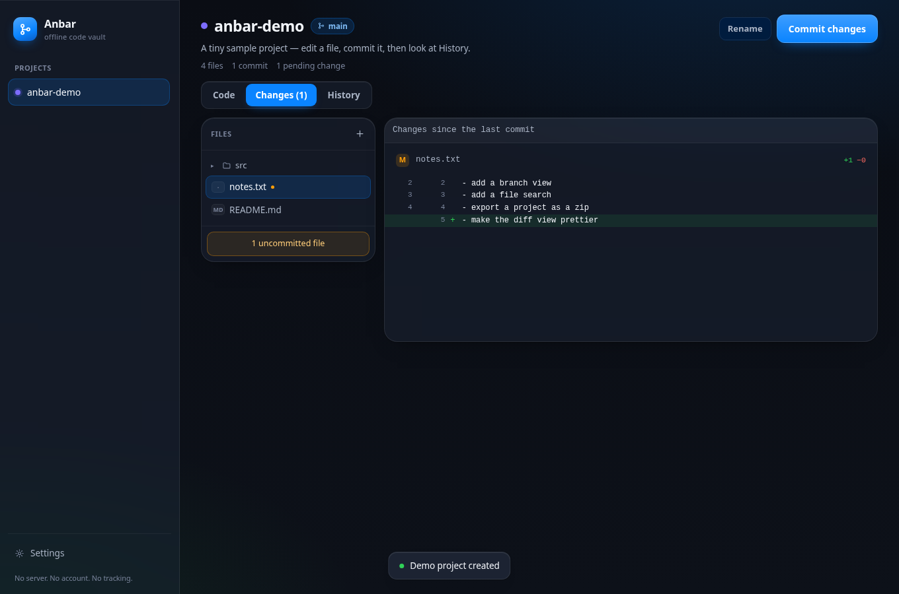
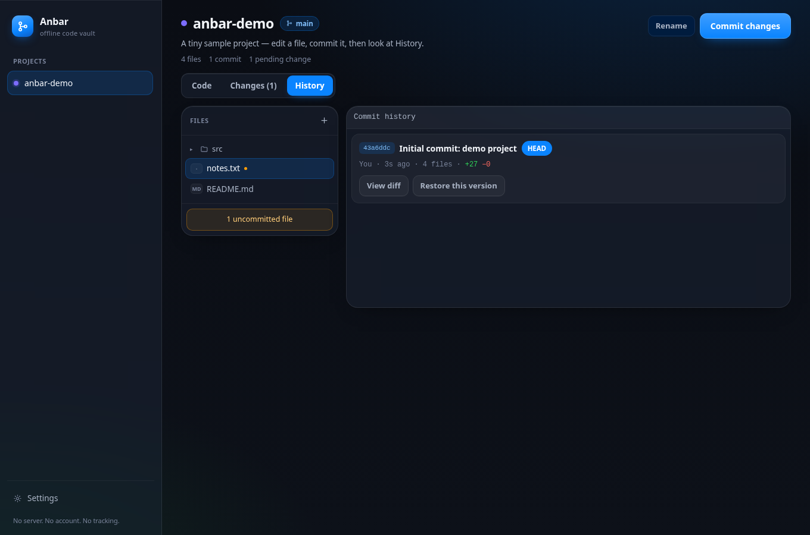
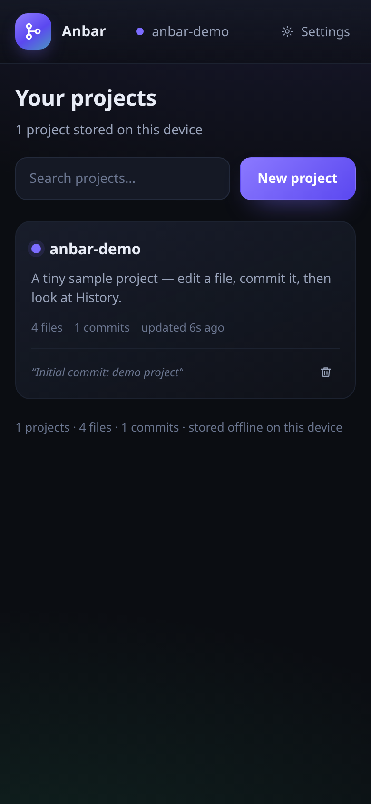

# Anbar · انبار

**A fast, fully offline workspace for your code — projects, files, commits and diffs, stored only on your device.**

Anbar is what a repository looks like when nobody else is watching: you open it, you write code,
you commit it, you look at the diff, you roll back. No server, no account, no sync, no telemetry.
Close the tab, lose the network, reboot — your work is still there, in your browser's own database.

یک فضای کار آفلاین برای کدهایت: پروژه، فایل، کامیت و دیف — همه فقط روی دستگاه خودت.
بدون سرور، بدون حساب، بدون همگام‌سازی و بدون ردیابی. اینترنت قطع شود هم کارت از دست نمی‌رود.



---

## Table of contents

- [Why it exists](#why-it-exists)
- [Features](#features)
- [Screens](#screens)
- [Install and run](#install-and-run)
- [Keyboard shortcuts](#keyboard-shortcuts)
- [How it works](#how-it-works)
- [Project layout](#project-layout)
- [Tests](#tests)
- [Roadmap](#roadmap)
- [فارسی](#فارسی)

## Why it exists

GitHub is a place. Anbar is a pocket. Sometimes you want the shape of a repository — files,
commits, history, diffs — for something that will never be pushed anywhere: a snippet, a
school assignment, a script you wrote on a phone, a project you want to keep private without
trusting a cloud. Anbar gives you that shape, and nothing leaves the machine.

Three rules shape the whole app:

1. **Offline is not a mode, it is the only mode.** There is not a single network request in the
   app. The service worker only exists so the files load from cache instantly.
2. **Your data is yours.** Everything lives in IndexedDB. Export it to one JSON file whenever
   you like, import it back on any device.
3. **Motion should feel alive, never slow.** Springs, not linear tweens; every transition is
   under 400 ms, and `prefers-reduced-motion` turns all of it off.

## Features

**Projects** — create, rename, describe, search and delete projects. Each one keeps its own
files, commits and history.

**File tree** — folders are real (create a file called `src/app.js` and the folder appears),
rename, delete, and a dot marks files with uncommitted edits.

**Code editor** — line numbers, syntax highlighting for JS/TS/Kotlin/Java/Python/CSS/HTML/JSON/
Markdown/Shell, autosave 700 ms after you stop typing, `Ctrl/⌘+S` to save instantly.

**Changes** — a real line diff of your working tree against the last commit: added, modified and
deleted files with `+n / −n` counts, and a unified diff with hunks of context.

**Commits** — message plus author, and a full snapshot of every file at that moment. HEAD is
marked in the history. Committing with nothing changed is refused, on purpose.

**History and restore** — every commit can show its diff against its parent, and one click puts
all files back to that version as *pending changes* — so you review and commit the rollback
instead of silently overwriting anything.

**Backup** — export every project, file and commit to a single JSON file; import it back with
one click.

**Installable app** — add Anbar to your Windows desktop or Android home screen from the browser
menu. It opens in its own window, offline, with no browser chrome.

**Crafted details** — dark and light themes, spring ("jelly") animations on every press, hover
and modal, a responsive layout that works from a 360 px phone to a wide monitor, focus states
that respect the keyboard, and toasts that never block what you are doing.

## Screens

| Code | Changes |
|---|---|
|  |  |

| History | Phone |
|---|---|
|  |  |

## Install and run

Anbar has **no build step and no dependencies**. Three ways to use it:

**1. Straight from the folder (simplest).** Download the repository and open `index.html` in your
browser. Everything works except the install prompt and the service worker, which browsers only
allow over `http(s)`.

**2. As a local server** (needed for offline install):

```bash
git clone https://github.com/amirmahdipa77-tech/anbar.git
cd anbar
python3 -m http.server 8080
# then open http://localhost:8080
```

**3. As an installed app**

- **Windows:** open the local URL in Edge or Chrome → *Apps* → *Install this site as an app*
  (or the install icon in the address bar). You get a desktop window, a Start-menu entry and a
  taskbar icon.
- **Android:** open the same URL in Chrome → menu → *Add to Home screen* → *Install*.
- Once installed, it runs with no network at all.

Hosting it anywhere static (GitHub Pages, a LAN box, a USB stick) works the same way — the
service worker pre-caches the whole app on first load.

## Keyboard shortcuts

| Keys | Action |
|---|---|
| `Ctrl/⌘ + S` | Save the open file |
| `Ctrl/⌘ + Enter` | Open the commit dialog |
| `Ctrl/⌘ + K` | Focus the project search |
| `Tab` (in the editor) | Insert two spaces |
| `Esc` | Close a dialog |

## How it works

```
index.html
├── assets/js/diff.js    line diff engine (LCS) + tree diff + hunking — pure, testable
├── assets/js/store.js   IndexedDB layer: repos, files, commits, export/import
├── assets/js/app.js     UI: router, rendering, modals, editor, actions
├── assets/css/anbar.css design system, jelly springs, responsive layout
├── manifest.webmanifest + sw.js   installable, offline shell
└── tools/make_icons.py  draws the app icons with PIL (no binary assets to trust)
```

**Storage model.** Three object stores. `repos` holds project metadata and a pointer to HEAD.
`files` is the working tree — one record per path, with its content. `commits` holds an immutable
snapshot of the whole tree plus a parent pointer, so history is a linked list of complete
versions: restoring is a copy, not a replay of patches.

**Diffing.** `diff.js` builds an LCS table over lines and backtracks it into `equal / add / del`
operations with line numbers on both sides. Long unchanged runs collapse into hunks with three
lines of context. Very large files (over ~4 million cell comparisons) fall back to a coarse diff
rather than freezing the tab.

**No framework.** Rendering is plain DOM with one delegated click handler, so the whole app is
about 1 700 lines of readable JavaScript and starts instantly on a mid-range phone.

## Project layout

```
anbar/
├── index.html
├── assets/
│   ├── css/anbar.css
│   ├── js/{diff,store,app}.js
│   └── icons/{icon-192,icon-512,icon-maskable-512}.png
├── screenshots/
├── tests/{diff,store,ui}.test.js
├── tools/make_icons.py
├── manifest.webmanifest
├── sw.js
├── LICENSE
└── README.md
```

## Tests

The logic is covered by 46 checks: the diff engine, the whole storage layer (on `fake-indexeddb`)
and a jsdom smoke test that boots the real UI, creates the demo project, switches tabs, opens a
file and autosaves it.

```bash
npm install --no-save jsdom fake-indexeddb
node tests/diff.test.js
node tests/store.test.js
node tests/ui.test.js
```

## Roadmap

- Branching and merging on top of the same snapshot model
- Project-wide search and replace
- Import a folder from disk (`webkitdirectory`) and export a project as a zip
- Optional end-to-end encrypted sync between two of your own devices — off by default, forever
- A Kotlin + Compose Multiplatform build for Android and Windows, sharing the same storage and
  diff design

## License

MIT — see [LICENSE](LICENSE). Use it, fork it, ship it, rename it.

Built by **Amirmahdi Pop** · [github.com/amirmahdipa77-tech](https://github.com/amirmahdipa77-tech)

---

## فارسی

**انبار** یک فضای کار کامل و آفلاین برای کد است: پروژه می‌سازی، فایل اضافه می‌کنی، ادیتور با
شماره خط و رنگ‌بندی سینتکس، بعد کامیت می‌کنی و تفاوت‌ها (دیف) را خط‌به‌خط می‌بینی. هر کامیت یک
نسخه کامل از همه فایل‌ها را نگه می‌دارد، پس هر لحظه می‌توانی به هر نسخه قبلی برگردی.

**قواعد اصلی**

- هیچ درخواست شبکه‌ای در برنامه وجود ندارد. آفلاین یک حالت نیست، تنها حالت است.
- داده‌ها در IndexedDB مرورگر روی دستگاه خودت ذخیره می‌شوند؛ با یک کلیک به یک فایل JSON
  پشتیبان می‌گیری و روی هر دستگاه دیگری برمی‌گردانی.
- انیمیشن‌ها فنری و روان‌اند، همه زیر ۴۰۰ میلی‌ثانیه، و اگر سیستم‌ات «کاهش حرکت» را روشن کرده
  باشد خودکار خاموش می‌شوند.

**نصب روی ویندوز و اندروید**

- **ویندوز:** پوشه را دانلود کن و `index.html` را باز کن، یا برای نصب واقعی در پوشه‌اش
  `python3 -m http.server 8080` را اجرا کن و در Edge یا Chrome آدرس `http://localhost:8080`
  را باز کن و از منوی برنامه‌ها «Install this site as an app» را بزن. یک پنجره مستقل با آیکن
  در استارت‌منو و تسک‌بار می‌گیری.
- **اندروید:** همان آدرس را در Chrome باز کن، منو → «Add to Home screen» → «Install».
- بعد از نصب، حتی بدون اینترنت هم باز می‌شود.

**میان‌برهای کلیدی:** `Ctrl/⌘+S` ذخیره فایل، `Ctrl/⌘+Enter` پنجره کامیت، `Ctrl/⌘+K` جست‌وجوی
پروژه، `Esc` بستن پنجره.

**تست‌ها:** ۴۶ بررسی خودکار (موتور دیف، لایه ذخیره‌سازی و یک تست رابط کاربری با jsdom) که همه
سبز هستند؛ دستور اجرایشان در بخش Tests بالاست.

**لایسنس:** MIT — آزاد برای استفاده، تغییر و انتشار.

ساختهٔ **امیرمهدی پاپ**
