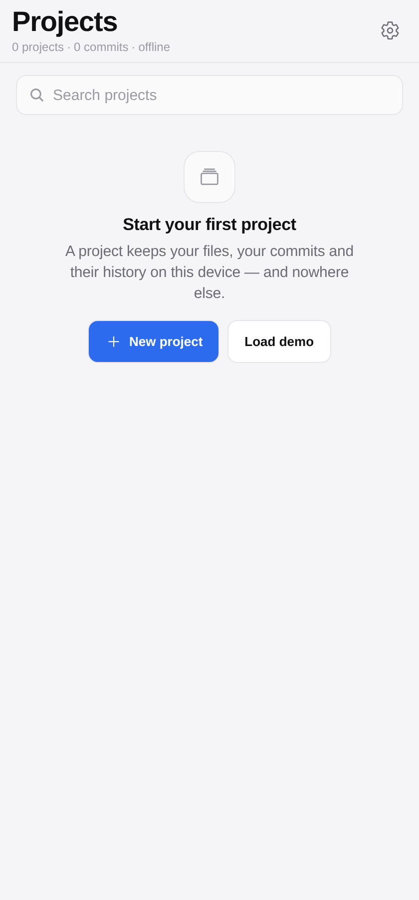
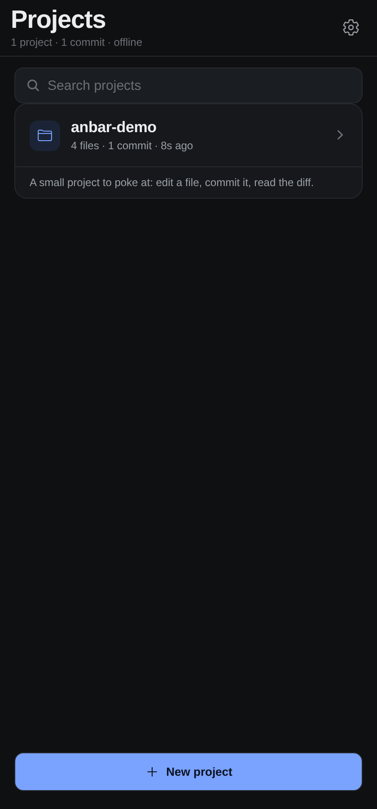
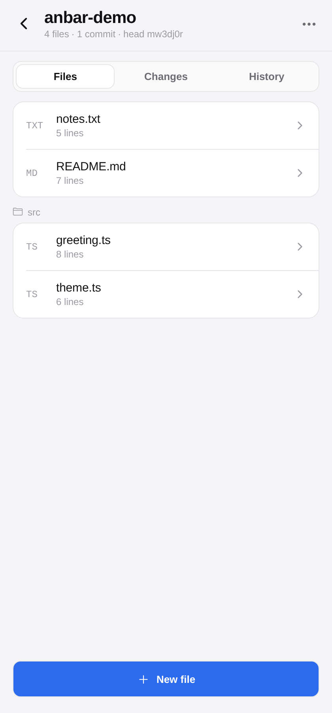
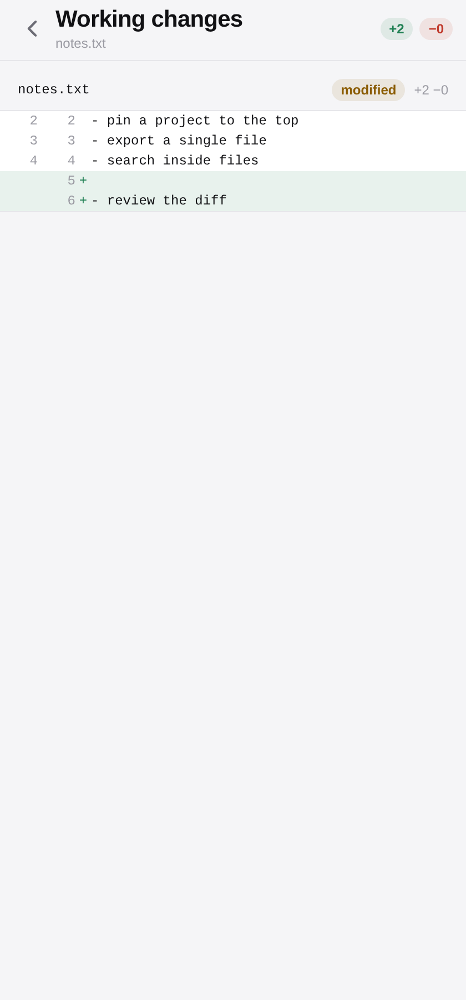
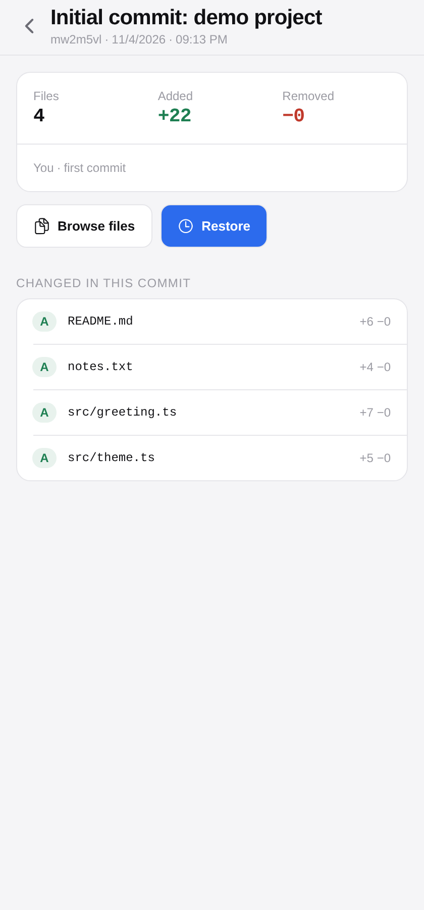
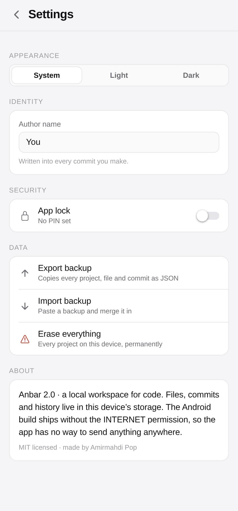

# Anbar

**A quiet, offline workspace for your code — projects, files, commits and diffs, on the device in your hand.**

Anbar is a React Native app for Android (it also builds to the web). It gives you the shape of a
repository — files, commits, history, diffs — without a server, an account, or a single network
request. The Android build ships **without the INTERNET permission**, so the app has no technical
way to send anything anywhere.

یک فضای کار آفلاین برای کد: پروژه، فایل، کامیت و دیف، فقط روی گوشی خودت.

| Light | Dark |
|---|---|
|  |  |

| Workspace | Diff |
|---|---|
|  |  |

| Commit | Settings |
|---|---|
|  |  |

---

## Why it exists

A repo is a good idea even when nobody else will ever read it: a snapshot you can return to, a
diff that shows what actually changed, a history that outlives your memory of it. Anbar keeps that
idea for the things you write on a phone or a laptop and never want to push anywhere.

Two rules decide every feature:

1. **Nothing leaves the device.** No accounts, no sync, no analytics, no fonts fetched at runtime.
   The APK has no INTERNET permission at all — that is a build-time guarantee, not a promise.
2. **The interface stays quiet.** One accent colour, hairline dividers, flat surfaces, short eased
   motion. No gradients, no glow, no bounce.

## Features

- **Projects** — create, describe, rename, delete, search. Each keeps its own files and history.
- **Files** — real folders (name a file `src/app.ts`), rename, delete, line counts, edited markers.
- **Editor** — monospace, autosave after 650 ms, explicit save on blur, live line and character
  counts, dirty state in the header.
- **Changes** — a real line diff of your working tree against the last commit, with `+n / −n`
  counts and a unified diff with three lines of context.
- **Commits** — message, author, and a full snapshot of every file. Empty commits and no-op commits
  are refused on purpose.
- **History** — every commit with its own diff against its parent, a read-only browser for the
  files inside any snapshot, and one-tap restore that lands as *pending changes* so you review the
  rollback before committing it.
- **Find** — search inside every file of a project, grouped by file, jumping straight to the file.
- **App lock** — a 4–6 digit PIN (only a salted SHA-256 hash is stored), optional biometric unlock,
  auto-lock after a chosen delay, and immediate re-lock when the app goes to the background.
- **Backup** — export every project, file and commit as one JSON blob to the clipboard; import it
  back on any device.
- **Appearance** — match the system, or pin light or dark.

## Install

**Android (sideload).** Download `anbar-2.0.0.apk` from
[Releases](https://github.com/amirmahdipa77-tech/anbar/releases/latest), open it on the phone, and
allow installing from this source when Android asks. The APK is signed with the standard Android
debug key — fine for sideloading and for personal use; publishing on Play would need your own
release key.

**Web.** The same code exports to a static site; it is deployed from `main` to
**https://amirmahdipa77-tech.github.io/anbar/**. Everything is stored in the browser's own storage.

**Build it yourself.**

```bash
git clone https://github.com/amirmahdipa77-tech/anbar.git
cd anbar
npm install

npm run typecheck      # TypeScript, strict
npm test               # 25 logic checks
npx expo export --platform web   # static web build into dist/

# Android APK (needs the Android SDK + JDK 17 on your machine)
npx expo prebuild --platform android
cd android && ./gradlew assembleRelease
```

The CI does exactly this: `.github/workflows/android.yml` builds the APK on every tag and attaches
it to the release, and `.github/workflows/web.yml` publishes the web build.

## Design notes

The palette is one neutral ramp plus a single accent (`#2C6BED` light, `#7AA2FF` dark). Surfaces
are flat; separation comes from a 1 px hairline and from space, never from shadow. Shadow appears
once, under the bottom sheet, because there it communicates elevation.

Type is the system font at 28/21/17/15/13/12 with tight tracking on headings, so the app reads like
the platform it runs on. Numbers that matter — commit ids, line counts, diff stats — are monospace.

Motion is short and eased (`cubic-bezier(0.4, 0, 0.2, 1)`, 140–280 ms). Sheets slide 28 px and fade;
rows dim to 60 % while pressed; nothing springs, nothing bounces. The lock screen shakes once on a
wrong PIN, and that is the only animation with personality.

Every list is a real row with a 44 px touch target, every destructive action asks first, and every
screen has a visible way back.

## Architecture

```
App.tsx                  routing state, settings, lock gate, app lifecycle
src/theme.ts             one palette per theme, spacing, radii, type, motion
src/types.ts             Project, Commit, FileTree, Change, DiffOp, Settings
src/core/diff.ts         LCS line diff, tree diff, hunking (pure, tested)
src/core/format.ts       time, plural, bytes, ids
src/storage/db.ts        AsyncStorage repository: index, per-project blob, commits
src/security/pin.ts      salted SHA-256 PIN, biometrics, settings persistence
src/ui/kit.tsx           theme provider, text, buttons, rows, sheet, toast, segmented
src/screens/*            dashboard, workspace, editor, diff, commit, viewer, find, settings, lock
tests/run.js             the logic suite (runs the real storage code on a memory adapter)
```

**Storage.** One key holds the project index; one key per project holds the whole world —
`{ files, commits }`. Every commit stores a complete tree, so restoring is a copy and history can
never be corrupted by a bad patch. Writes go through a promise queue, so two taps can never
interleave a read-modify-write.

**Diffing.** An LCS table over lines, backtracked into `equal / add / del` operations carrying line
numbers on both sides. Long unchanged runs collapse into hunks with three lines of context. Files
larger than ~4 million cell comparisons fall back to a coarse diff rather than freezing the UI.

**Security.** The PIN is never stored: a random 16-byte salt and `SHA-256(salt:pin)` live in
settings, verification re-hashes the input. Biometrics are delegated to the OS keyguard. On Android
the manifest blocks `INTERNET`, `ACCESS_NETWORK_STATE` and `ACCESS_WIFI_STATE`.

More detail in [`docs/ARCHITECTURE.md`](docs/ARCHITECTURE.md).

## Tests

```bash
npm test
```

25 checks: eleven for the diff engine (empty files, CRLF, trailing newlines, hunking, the large-file
fallback) and fourteen for the storage layer (duplicate names, path traversal, empty and no-op
commits, parent links, restore, rename, export/import round-trip, cascade delete, demo seeding,
commit-vs-parent diffs). The storage tests run the real module against an in-memory AsyncStorage, so
no function of ours is mocked.

## Roadmap

- Branching on top of the same snapshot model
- Pin a project to the top; archive instead of delete
- Import a folder from the device, export a single file
- Optional end-to-end encrypted sync between two of your own devices — off by default, forever
- Play Store build with a proper release key

## License

MIT — see [LICENSE](LICENSE). Use it, fork it, rename it.

Built by **Amirmahdi Pop** · [github.com/amirmahdipa77-tech](https://github.com/amirmahdipa77-tech)

---

## فارسی

**انبار** یک اپلیکیشن React Native برای اندروید است (و به وب هم بیلد می‌شود) که همان شکل یک
مخزن کد را به تو می‌دهد: فایل، کامیت، تاریخچه و دیف — بدون سرور، بدون حساب و بدون حتی یک درخواست
شبکه. نسخه اندروید **مجوز اینترنت ندارد**؛ یعنی در سطح سیستم‌عامل راهی برای فرستادن داده به بیرون
ندارد.

**قابلیت‌ها**

- پروژه‌ها با توضیح، تغییر نام، حذف و جست‌وجو
- فایل و پوشه واقعی، تغییر نام و حذف، شمارش خطوط
- ادیتور مونواسپیس با ذخیره خودکار و وضعیت «تغییر یافته»
- تب Changes با دیف خط‌به‌خط و شمارش `+n / −n`
- کامیت با پیام و نویسنده و یک نسخه کامل از همه فایل‌ها
- تاریخچه با دیف هر کامیت نسبت به قبلی، مرور فایل‌های هر نسخه و بازگردانی یک‌کلیکی
- جست‌وجو داخل همه فایل‌های یک پروژه
- قفل برنامه با پین ۴ تا ۶ رقمی (فقط هش نمکی SHA-256 ذخیره می‌شود)، اثر انگشت، قفل خودکار
- پشتیبان‌گیری و بازگردانی به شکل JSON
- تم روشن، تیره یا هماهنگ با سیستم

**نصب:** فایل `anbar-2.0.0.apk` را از بخش Releases دانلود کن و روی گوشی باز کن. نسخه وب هم روی
`https://amirmahdipa77-tech.github.io/anbar/` بالا است.

**طراحی:** یک رنگ تأکید، سطوح تخت، خطوط موی‌باریک، بدون سایه و بدون درخشش؛ انیمیشن‌ها کوتاه و
آرام. تایپوگرافی سیستم با فاصله‌گذاری دقیق.

**تست:** ۲۵ بررسی خودکار روی موتور دیف و لایه ذخیره‌سازی؛ دستورش `npm test` است.

**لایسنس:** MIT — آزاد برای استفاده و تغییر. ساختهٔ امیرمهدی پاپ.
