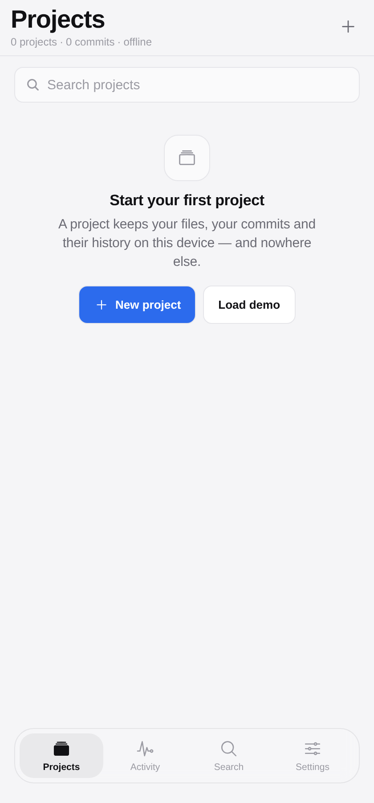
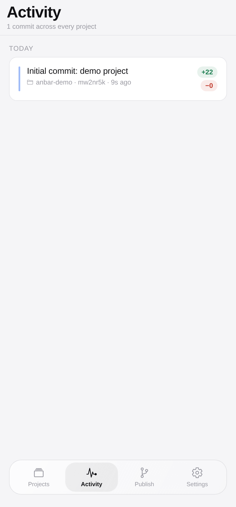
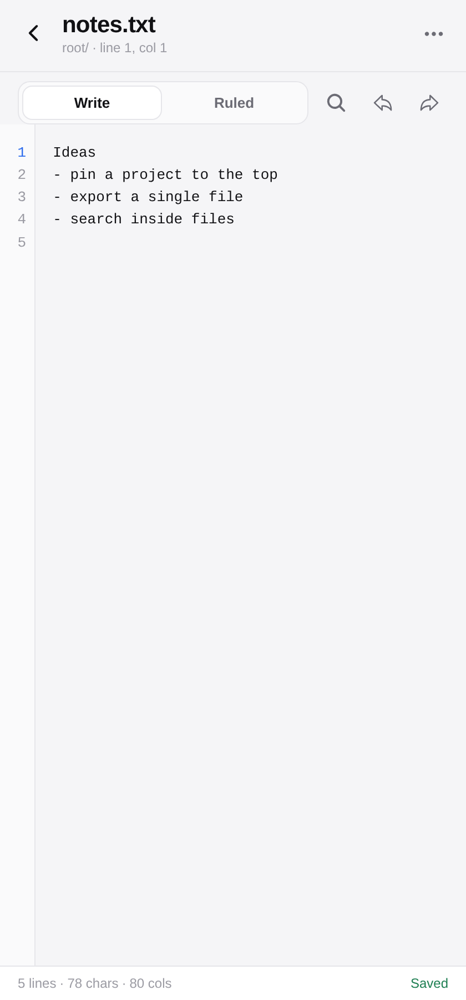
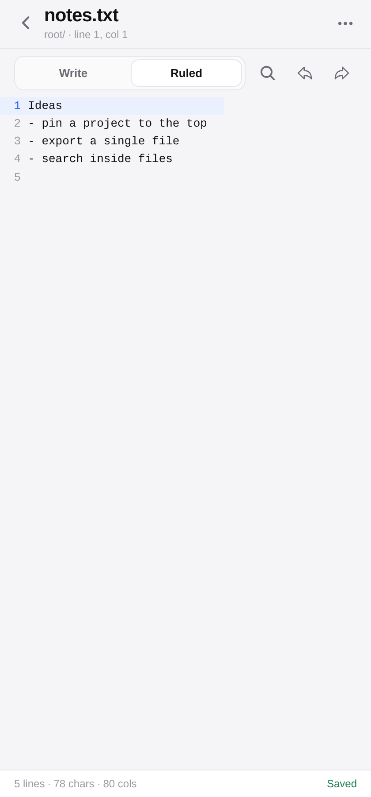
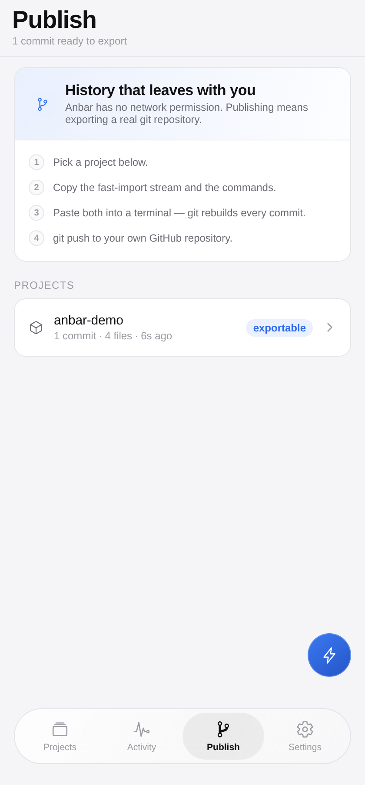
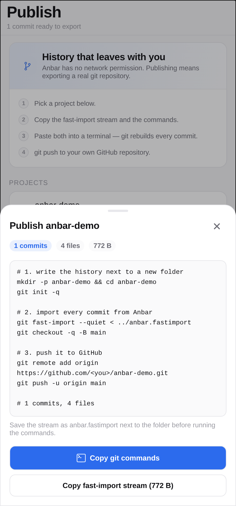

# Anbar

**A quiet, offline workspace for your code — projects, files, commits and diffs, on the device in your hand.**

Anbar is a React Native app for Android (it also builds to the web). It gives you the shape of a
repository — files, commits, history, diffs — without a server, an account, or a single network
request. The Android build ships **without the INTERNET permission**, so the app has no technical
way to send anything anywhere.

یک فضای کار آفلاین برای کد: پروژه، فایل، کامیت و دیف، فقط روی گوشی خودت.

| Projects | Activity |
|---|---|
|  |  |

| Editor | Ruled view |
|---|---|
|  |  |

| Publish | Export |
|---|---|
|  |  |

---

## Why it exists

A repo is a good idea even when nobody else will ever read it: a snapshot you can return to, a diff
that shows what actually changed, a history that outlives your memory of it. Anbar keeps that idea
for the things you write on a phone and never want to push anywhere.

Two rules decide every feature:

1. **Nothing leaves the device.** No accounts, no sync, no analytics. The APK has no INTERNET
   permission at all — a build-time guarantee, not a promise.
2. **The interface stays quiet.** One accent colour, hairline dividers, flat surfaces, short eased
   motion. No gradients, no glow, no bounce.

## The floating bar

Navigation is a single glass pill that hovers above the content — blurred, translucent, with a soft
highlight that slides between tabs instead of blinking on and off. Four places: **Projects**,
**Activity** (every commit across every project, grouped by day), **Publish** (export the whole
history as a real git repository) and **Settings**. Inside a project the bar steps aside, so the file, the diff and the
commit get the whole screen.

## The editor

Two modes, because typing and reading want different layouts:

- **Write** — monospace input with a line-number gutter that scrolls in sync, the current line
  highlighted, autosave after 650 ms, undo/redo, and a column ruler drawn at 72, 80 or 100
  characters.
- **Ruled** — a precise, non-wrapping render: every line is its own row, so the gutter, the ruler and
  the horizontal scroll can never drift out of alignment. Tap a line to jump into editing at that
  line.

The **File tools** sheet holds the rest: ruler on/off, font size, duplicate line, move line up or
down, go to line, rename or move the file, delete. Find-in-file has next/previous, replace one and
replace all. The header always shows `line X, col Y`.

## Features

- **Projects** — create, describe, rename, delete, search.
- **Files** — real folders (`src/app.ts`), rename, move, delete, line counts, edited markers.
- **Changes** — a real line diff of your working tree against the last commit, with `+n / −n` and a
  unified diff with three lines of context.
- **Commits** — message, author, a full snapshot of every file. Empty and no-op commits are refused.
- **History** — per-commit diff against its parent, a read-only browser of the snapshot's files, and
  restore that lands as *pending changes* so you review the rollback before committing it.
- **Activity** — every commit across every project, grouped by day, one tap from the diff.
- **Publish** — turn a project into a `git fast-import` stream with every commit, message, author
  and timestamp, plus the three commands that import it and push it to your own GitHub repository.
  The app never uploads anything: the push happens in your terminal, which is the only way to keep
  the no-network promise.
- **App lock** — 4–6 digit PIN stored only as a salted SHA-256 hash, optional biometric unlock,
  configurable auto-lock, immediate lock when the app is backgrounded.
- **Backup** — export everything as one JSON blob to the clipboard; import it back anywhere.
- **Appearance** — match the system, or pin light or dark.

## Install

**Android (sideload).** Download `anbar-2.4.1.apk` from
[Releases](https://github.com/amirmahdipa77-tech/anbar/releases/latest), open it on the phone, and
allow installing from this source when Android asks. It is signed with the standard Android debug
key — fine for sideloading, not for Play.

**Web.** The same code exports to a static site, deployed from `main` to
**https://amirmahdipa77-tech.github.io/anbar/**.

**Build it yourself.**

```bash
git clone https://github.com/amirmahdipa77-tech/anbar.git
cd anbar
npm install
npm run typecheck      # strict TypeScript
npm test               # 25 logic checks
npx expo export --platform web        # static web build into dist/
npx expo prebuild --platform android  # then: cd android && ./gradlew assembleRelease
```

CI does the same: `.github/workflows/android.yml` builds the APK on every tag and attaches it to the
release; `.github/workflows/web.yml` publishes the web build.

## Size

The APK used to be 70 MB because it carried four CPU architectures and no minification. Release
builds now run R8 with full mode, shrink resources, crunch PNGs and keep only `arm64-v8a`
(`tools/trim_android.py` enforces all three in CI). That is roughly a third of the old size, and it
still installs on any 64-bit Android phone from the last several years.

## Design notes

One neutral ramp plus a single accent (`#2C6BED` light, `#7AA2FF` dark). Surfaces are flat;
separation comes from a 1 px hairline and from space, never from shadow. Shadow appears twice only —
under the bottom sheet and under the floating bar — because there it communicates elevation.

Type is the system font at 28/21/17/15/13/12 with tight tracking on headings. Numbers that matter —
commit ids, line numbers, diff stats — are monospace.

Motion is short and eased (`cubic-bezier(0.4, 0, 0.2, 1)`, 140–280 ms). The tab highlight slides;
sheets rise 28 px and fade; rows dim to 60 % while pressed. Nothing springs. The lock screen shakes
once on a wrong PIN, and that is the only animation with personality.

## Architecture

```
App.tsx                  tab state, route stack, settings, lock gate, lifecycle
src/theme.ts             palette per theme, spacing, radii, type, motion, nav metrics
src/types.ts             Project, Commit, FileTree, Change, DiffOp, Settings
src/core/diff.ts         LCS line diff, tree diff, hunking (pure, tested)
src/storage/db.ts        AsyncStorage repository + activity feed + global search
src/security/pin.ts      salted SHA-256 PIN, biometrics, settings
src/ui/kit.tsx           theme provider, text, buttons, rows, sheet, toast, segmented
src/ui/BottomNav.tsx     the floating glass bar and its sliding highlight
src/screens/*            projects, workspace, editor, diff, commit, viewer, find,
                         activity, search, settings, lock
tests/run.js             the logic suite, on a real in-memory AsyncStorage
```

**Storage.** One key holds the project index; one key per project holds the whole world —
`{ files, commits }`. Every commit stores a complete tree, so restoring is a copy and history can
never be corrupted by a bad patch. Writes go through a promise queue, so two taps can never
interleave a read-modify-write.

**Diffing.** An LCS table over lines, backtracked into `equal / add / del` operations carrying line
numbers on both sides. Long unchanged runs collapse into hunks with three lines of context. Files
above ~4 million cell comparisons fall back to a coarse diff rather than freezing the UI.

**Security.** The PIN is never stored: a random 16-byte salt and `SHA-256(salt:pin)` live in
settings, verification re-hashes the input. Biometrics are delegated to the OS keyguard. On Android
the manifest blocks `INTERNET`, `ACCESS_NETWORK_STATE` and `ACCESS_WIFI_STATE`.

More detail in [`docs/ARCHITECTURE.md`](docs/ARCHITECTURE.md).

## Tests

```bash
npm test
```

25 checks: eleven for the diff engine and fourteen for the storage layer, which run the real module
against an in-memory AsyncStorage — no function of ours is mocked.

## Roadmap

- Branching on top of the same snapshot model
- Pin a project to the top; archive instead of delete
- Import a folder from the device, export a single file
- Optional end-to-end encrypted sync between two of your own devices — off by default, forever
- Play Store build with a proper release key

## License

MIT — see [LICENSE](LICENSE).

Built by **Amirmahdi Pop** · [github.com/amirmahdipa77-tech](https://github.com/amirmahdipa77-tech)

---

## فارسی

**انبار** یک اپلیکیشن React Native برای اندروید است (و به وب هم بیلد می‌شود) که همان شکل یک مخزن
کد را می‌دهد: فایل، کامیت، تاریخچه و دیف — بدون سرور، بدون حساب و بدون حتی یک درخواست شبکه. نسخه
اندروید **مجوز اینترنت ندارد**.

**نوار پایین شناور:** ناوبری یک قرص شیشه‌ای مات و شفاف است که روی محتوا شناور می‌ماند و هایلایتش
با انیمیشن نرم بین چهار تب می‌لغزد: پروژه‌ها، فعالیت، جست‌وجو و تنظیمات. داخل پروژه، نوار کنار
می‌رود تا فایل و دیف تمام صفحه را بگیرند.

**ادیتور:** دو حالت دارد — «Write» با شماره خط همگام، هایلایت خط جاری، ذخیره خودکار، undo/redo و
خط‌کش ستونی روی ۷۲/۸۰/۱۰۰ کاراکتر؛ و «Ruled» که هر خط را جدا رندر می‌کند تا شماره‌ها و خط‌کش هرگز
از هم جدا نشوند، با امکان پرش به ویرایش همان خط. شیت «File tools» هم خط‌کش، اندازه فونت، تکثیر خط،
جابه‌جایی خط، پرش به خط، تغییر نام/جابه‌جایی فایل و حذف را دارد.

**قابلیت‌ها:** پروژه‌ها با توضیح و جست‌وجو، فایل و پوشه واقعی، دیف خط‌به‌خط، کامیت با نسخه کامل،
تاریخچه با دیف نسبت به والد و بازگردانی، فعالیت همه پروژه‌ها، جست‌وجو در همه فایل‌ها، قفل با پین و
اثر انگشت، پشتیبان JSON و تم روشن/تیره/سیستم.

**نصب:** فایل `anbar-2.4.1.apk` را از Releases دانلود کن. نسخه وب هم روی
`https://amirmahdipa77-tech.github.io/anbar/` است.

**تست:** ۲۵ بررسی خودکار با `npm test`. لایسنس MIT. ساختهٔ امیرمهدی پاپ.
